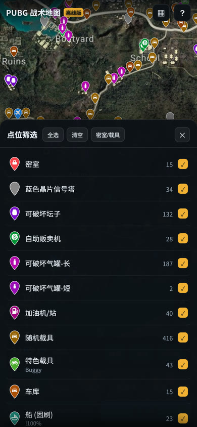
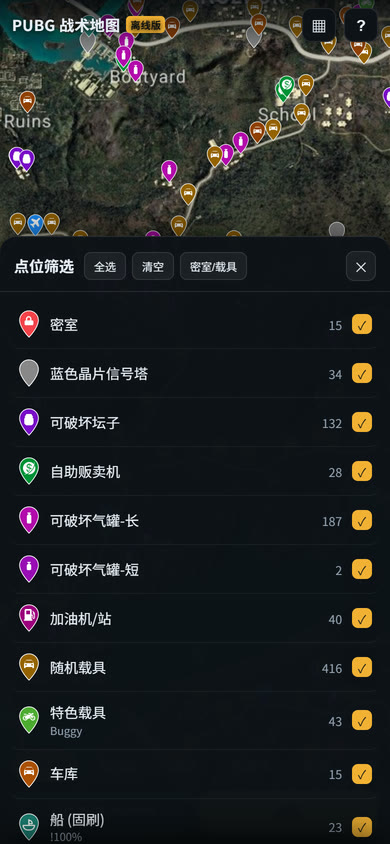

# PUBG 战术地图 · 离线版

[](https://github.com/boys506/pubg-map/releases/latest)
[](https://github.com/boys506/pubg-map/releases/latest/download/PUBG-OfflineMap-1.0.apk)

把 [pubg.plus](https://pubg.plus/zh-CN/map) 的**地图测距**和**地图点位**功能做成了一台手机可以完全离线使用的 APK。

## 产物

- **[下载 APK（Releases）](https://github.com/boys506/pubg-map/releases/latest)** — 40.7 MB，签名可直装（Android 7.0+，不需要任何网络权限）
- APK 只存在 Release 里，**不入库**（仓库本体约 500 KB，clone 很轻）

## 界面

| 地图 + 点位 | 测距 |
| :---: | :---: |
|  |  |
| **点位筛选** | **迫击炮解算** |
|  |  |

## 安装

1. 把 APK 传到手机（微信/QQ 传输、数据线、网盘均可）。
2. 点击安装，系统提示"未知来源"时允许即可。
3. 首次打开即用，之后飞行模式下也能正常查看地图与点位。

## 功能

| 功能 | 说明 |
| --- | --- |
| 离线地图 | 10 张地图（艾伦格 / 米拉玛 / 泰戈 / 帝斯顿 / 荣都 / 维寒迪 / 萨诺 / 帕拉莫 / 卡拉金 / 褐湾），1–4 级瓦片共 3400 张，全部打包在 APK 内 |
| 测距 | 「测距」模式点地图打点，实时显示分段距离与总距离；测距点可拖动微调，支持撤销/清空 |
| 点位查询 | 密室、载具、加油站、自助贩卖机、金库、可破坏坛子、气罐、滑翔机等 37 类点位，按地图给出实际存在的类型与数量，可逐类开关，支持筛选预设 |
| 迫击炮计算 | 按 PUBG 弹道模型（最大水平射程 700 m）解算：填高差 → 输出密位 R 与仰角 θ |
| 辅助 | 1 km 网格、比例尺、光标坐标、点位详情（坐标 + 类型标签） |

## 与网页版的差异

- 迫击炮解算需要**手动填高差**：网页版用的是站点自己的地形高度数据，离线包里没有打包高程数据。
- 未包含蓝圈自定义 / 渡轮火车模拟 / 2D 回放，这些属于网页版其它模块。
- 地图最高放大到 4 级瓦片（约 2 m/像素），再放大是像素插值。

## 数据来源与版权

- 地图瓦片、点位数据抓取自 **PUBG.PLUS**，站点要求转载时署名，APK 内已保留「点位数据 © PUBG.PLUS」标识与关于页说明。
- 地图与游戏素材版权归 KRAFTON / PUBG 所有，本工具仅供个人离线查看，非官方产品。

## 目录结构

```
app/                 网页版应用（可直接用浏览器打开调试）
  index.html
  css/app.css
  js/app.js          Canvas 地图引擎 + 测距 + 点位渲染
  data/data.js       点位与地图元数据（含 37 类图标 SVG）
android/             Android 工程（WebView 容器，无网络权限）
build/
  get_tiles.py       瓦片下载（assets-esa 节点最快）
  build_data.py      抓取结果 → app/data/data.js
  build_apk.sh       一键出包（aapt2 → javac → d8 → zipalign → apksigner）
  tiles/             瓦片原始文件（不入库，按需下载）
capture/             抓包脚本（puppeteer-core + 系统 Edge）
  getpoints.js       拉取各图各类型点位
  decall.js          AES-256-GCM + raw deflate 解密点位
dist/                本地构建产物（APK 不入库，已 gitignore）
```

## 从源码重建

仓库不含瓦片、Android SDK、node_modules 等大文件，只放源码与成品 APK。想自己重新出包：

```bash
python build/get_tiles.py build/tiles Erangel 1 4   # 逐张地图下载瓦片
bash build/build_apk.sh                             # 需要 JDK 17+ 与 Android build-tools
```

## 更新点位数据

点位走接口 `GET https://apiv1.pubg.plus/map/points?map=<地图>&type=<类型>`，返回体是
`base64(iv|AES-256-GCM密文)`，密钥 = `SHA-256(Ve)`，`Ve` 由前端包内常量拼出，
解出后还要做一次 raw deflate。`capture/decall.js` 已实现完整链路。

```bash
cd capture && node getpoints.js && node decall.js   # 重新抓取并解密
cd .. && python build/build_data.py                 # 生成 data.js
bash build/build_apk.sh                             # 重新出包
```

## 发版

APK 不入库，只放在 Release 里。推 `v*` 标签会触发 `.github/workflows/release.yml`（内置 `GITHUB_TOKEN`，无需配置 secret）：

```bash
bash build/build_apk.sh                              # 先出包到 dist/
git tag -a v1.0.1 -m "v1.0.1" && git push origin v1.0.1
```

因为仓库里没有 APK，Action 会建一个**草稿 Release**。到 Releases 页面点开草稿，把 `dist/PUBG-OfflineMap-*.apk` 拖进附件区，再点 Publish。
不想开浏览器也可以直接命令行补传：

```bash
gh release upload v1.0.1 dist/PUBG-OfflineMap-1.0.apk
```

发版说明改 `.github/RELEASE_NOTES.md`。

## 已知限制

- 瓦片和点位是 2026-11-21 的快照，游戏版本更新后点位可能变化。
- 迫击炮最高只能算 700 m 内的目标，超出会提示"超过最大射程"（与游戏一致）。
- 未在真机验证安装（本地无 Android 设备/模拟器），如遇到白屏请反馈，多为 WebView 版本过旧。
