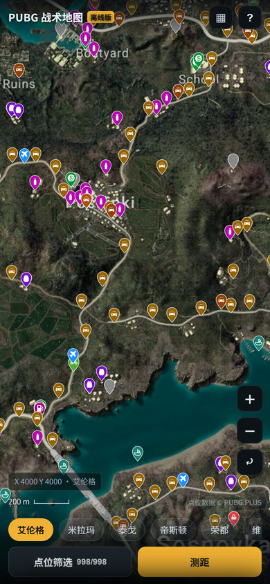
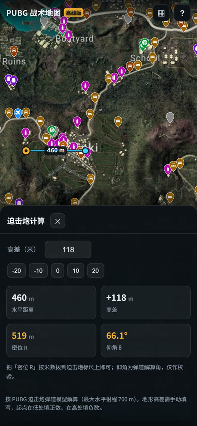

<div align="center">

# PUBG 战术地图 · 离线版

**把 PUBG 的十张地图装进手机：测距、点位、迫击炮解算，断网也能用。**

[](https://github.com/boys506/pubg-map/releases/latest/download/PUBG-OfflineMap-1.0.apk)
[](https://github.com/boys506/pubg-map/releases/latest)


</div>

<div align="center">
  
  
  
  
</div>

## 这是什么

[pubg.plus](https://pubg.plus/zh-CN/map) 的网页版地图好用，但**跳伞落地前那几秒没有网络**，比赛中途切后台也会掉线。这个 APK 把它最实用的两个功能抽出来做成了完全离线的本地应用：

- 十张地图的瓦片、37 类点位坐标全部打包进安装包，**应用不申请任何网络权限**，飞行模式下照常打开
- 界面不是套壳网页，而是自己写的 Canvas 瓦片引擎，滑动缩放跟原生一样跟手
- 安装包 40.7 MB，Android 7.0 以上直接装

## 功能

| | 功能 | 说明 |
| :---: | --- | --- |
| **地图** | 十张地图离线浏览 | 艾伦格 / 米拉玛 / 萨诺 / 维寒迪 / 卡拉金 / 帕拉莫 / 褐湾 / 泰戈 / 帝斯顿 / 荣都，1–4 级瓦片共 3400 张 |
| **测距** | 多点折线测量 | 点地图打点，每段距离实时标在线上，底部显示总距离；顶点可拖动微调，支持撤销 / 清空 |
| **点位** | 分类查询与开关 | 密室、载具、加油站、自助贩卖机、金库、可破坏坛子、气罐、滑翔机等 37 类，按地图给出实际存在的类型与数量，可逐类开关 |
| **迫击炮** | 密位与仰角解算 | 按游戏弹道模型（最大水平射程 700 m）解算，填高差即得密位 R 与仰角 θ |
| **辅助** | 网格 / 比例尺 / 坐标 | 1 km 网格、动态比例尺、光标处坐标、点位详情（类型 + 坐标 + 标签） |

## 安装

1. 手机下载上面的 **下载 APK**（40.7 MB）
2. 点击安装，系统提示「未知来源」时允许
3. 打开即用，无需登录、无需联网

> 如果打开是白屏，多半是系统 WebView 版本过旧，去应用商店更新「Android System WebView」即可。

## 与网页版的差别

| | 网页版 | 本应用 |
| --- | --- | --- |
| 网络 | 需要联网 | **完全离线**，无网络权限 |
| 迫击炮高差 | 自动读地形高程 | **需手动填写**（离线包不含高程数据） |
| 最大放大 | 可继续放大 | 4 级瓦片上限，约 2 m/像素，再放大为插值 |
| 其它模块 | 蓝圈自定义、渡轮火车、2D 回放 | 未包含，只做测距与点位 |

## 数据是怎么来的

网页版没有开放数据接口，所以做了三件事：

1. **瓦片**：摸出地址规则 `assets/map/<地图>/<z>_<x>_<y>.jpg`（256 px），十张地图 1–4 级共 3400 张，48 MB
2. **点位**：接口返回的是 `base64(iv | AES-256-GCM 密文)`，密钥由前端包内常量拼出，解出后还要过一次 raw deflate。最终得到 9 张地图、37 类、6522 个坐标
3. **坐标**：还原出归一化体系 `x = p1 / 256`、`y = -p0 / 256`，地图跨度 = 地图边长（米）

迫击炮公式也一并校验过：站点里的 `M = 700` 是最大射程而非初速，用实测案例 460 m 水平 / +118 m 高差代入，得到 **519 密位**，与玩家实战打中的数字一致。

<details>
<summary><b>更新点位数据（进阶）</b></summary>

```bash
cd capture && node getpoints.js && node decall.js   # 重新抓取并解密点位
cd .. && python build/build_data.py                 # 生成 app/data/data.js
bash build/build_apk.sh                             # 重新出包
```

接口：`GET https://apiv1.pubg.plus/map/points?map=<地图>&type=<类型>`，解密链路见 `capture/decall.js`。

</details>

## 项目结构

```
app/                 应用本体（浏览器直接打开即可调试）
  index.html
  css/app.css
  js/app.js          Canvas 瓦片引擎 + 测距 + 点位渲染
  data/data.js       点位与地图元数据（含 37 类图标 SVG）
android/             Android 工程（WebView 容器，无网络权限）
build/
  get_tiles.py       瓦片下载（assets-esa 节点最快）
  build_data.py      抓取结果 → app/data/data.js
  build_apk.sh       一键出包（aapt2 → javac → d8 → zipalign → apksigner）
capture/             抓包脚本（puppeteer-core + 系统 Edge）
dist/                构建产物
```

<details>
<summary><b>自己构建</b></summary>

不包含瓦片、Android SDK、node_modules 等大文件，需要先下载素材：

```bash
python build/get_tiles.py build/tiles Erangel 1 4   # 逐张地图下载 1–4 级瓦片
bash build/build_apk.sh                             # 需 JDK 17+ 与 Android build-tools
```

</details>

## 已知限制

- 瓦片与点位是 **2026-11-21 的快照**，游戏版本更新后点位可能有出入
- 迫击炮只解算 700 m 内目标，超出提示「超过最大射程」（与游戏一致）
- 未在真机验证安装（开发机无 Android 设备），异常欢迎提 issue

## 版权与致谢

- 地图瓦片、点位数据来自 **[PUBG.PLUS](https://pubg.plus)**，按要求保留署名（APK 内关于页亦有说明）
- 地图与游戏素材版权归 **KRAFTON / PUBG** 所有
- 本项目为个人离线查看工具，非官方产品，请勿用于商业用途
